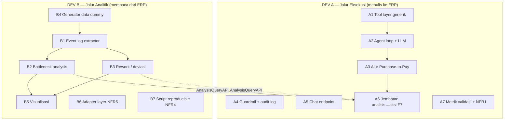

# DEV-TASKS.md — Pembagian Tugas 2 Developer (Dev A & Dev B)

> Dokumen kerja teknis untuk **2 developer** yang membangun `apps/smart_erp_ai`.
> Merujuk penuh ke `docs/SRS.md` (requirement F1–F8, NFR1–NFR6) dan `docs/AGENT-RULES.md` (aturan layer).
> Tujuan: setiap requirement punya **satu pemilik jelas**, beban seimbang, dan kedua developer bisa
> bekerja **paralel** dengan titik temu minimum.

---

## 0. Ringkasan Pembagian

Targetan dibelah menjadi **dua jalur yang hampir tidak bersinggungan**:



**Alasan pembagian:** Dev A seluruhnya bekerja di sekitar **menulis ke ERP** (tool, agen, guardrail,
chat, jembatan). Dev B seluruhnya di sekitar **membaca & menganalisis ERP** (ekstraksi, analitik, data,
visualisasi, adapter). Titik temu hanya **satu**: `AnalysisQueryAPI`. Setelah kontrak ini disepakati
di **Hari 1**, keduanya jalan paralel tanpa saling memblok.

**Cakupan:** pembagian ini menutup **seluruh** SRS — 8/8 Functional + 6/6 Non-Functional + Data
Requirement + Metrik Validasi. Peta cakupan ada di §5.

---

## 1. Kontrak Titik Temu (WAJIB disepakati Hari 1, jangan diubah sembarangan)

Didefinisikan di `apps/smart_erp_ai/smart_erp_ai/process_intelligence/api.py`.
**Dev B menyediakan, Dev A mengonsumsi.** Ini satu-satunya interface yang mengikat keduanya.

```python
# --- Kontrak AnalysisQueryAPI (v1) ---
def get_bottlenecks(process: str, period: str | None = None) -> list[dict]:
    """Tahap proses diurutkan dari yang terlama.
    Return: [{"stage": str, "avg_duration_hours": float,
              "median_duration_hours": float, "case_count": int}, ...]
    Contoh process: "purchase-to-pay". period: "2026-10", None = semua.
    """

def get_rework_cases(process: str, limit: int = 20) -> list[dict]:
    """Kasus yang mundur ke tahap sebelumnya / melewati urutan normal.
    Return: [{"case_id": str, "deviation": str,
              "from_stage": str, "to_stage": str, "timestamp": str}, ...]
    """

def get_pending_at_stage(process: str, stage: str) -> list[dict]:
    """Dokumen yang masih tertahan di sebuah tahap (dipakai untuk F7 & reminder).
    Return: [{"case_id": str, "reference": str, "age_hours": float, "owner": str}, ...]
    """
```

**Aturan:** bentuk return tidak berubah tanpa notifikasi Dev A. Perubahan = update dokumen ini.

> **Status implementasi (Dev B):** kontrak v1 **sudah tersedia** di
> `apps/smart_erp_ai/smart_erp_ai/process_intelligence/api.py`.
> Bentuk return sesuai persis di atas (adapter menambahkan field ekstra
> non-breaking seperti `label`, `is_bottleneck`, `stage`, `doctype`).
> Dev A boleh langsung mendaftarkannya sebagai tool (A6). Lihat
> `docs/DEV-B-STATUS.md` untuk detail & cara verifikasi.

---

## 2. DEV A — Jalur Eksekusi

Pemilik requirement: **F5, F6, F8, F7**, NFR1, NFR2, NFR3, NFR6.
Folder kerja: `agent/`, `tools/`, `api.py`.

### A1 — Tool Layer Generik `[F5]`
**Target:** 5 tool berbasis DocType: `list_documents`, `get_document`, `create_document`,
`update_document`, `submit_document`.

**Caranya:**
1. Buat `tools/registry.py` — daftar tool + skema parameter (JSON schema untuk LLM).
2. Buat `tools/frappe_tools.py` — implementasi. DocType & field **dari parameter**, bukan bercabang
   per fitur (AGENT-RULES RULE 2.3).
3. Pakai Frappe ORM bila dipanggil dari dalam app, atau REST API bila dari service luar.
4. **Allowlist DocType** (RULE 5.6): hanya DocType alur P2P + yang relevan.
5. Tambah `submit_document` sebagai **aksi berisiko** → butuh flag konfirmasi dari A2/A4.

**Acceptance:** dari Python shell, `create_document("Purchase Order", {...})` menghasilkan dokumen
nyata yang bisa dibuka di ERPNext Desk.

### A2 — Agent Loop + LLM `[F5]`
**Target:** loop function-calling yang mengubah pesan bahasa alami → pemanggilan tool.

**Caranya:**
1. `agent/llm.py` — client LLM via **API eksternal** (NFR6, jangan hosting model). API key dari
   env/site_config (RULE 5.5).
2. `agent/loop.py` — alur: susun messages → kirim + daftar tool → LLM pilih tool → eksekusi tool →
   umpan balik hasil → ulangi sampai LLM berhenti.
3. `agent/prompt.py` — system prompt: identitas agen, ruang lingkup (hanya P2P), aturan konfirmasi.
4. Batasi jumlah iterasi (mis. maks 6) untuk mencegah loop tak berujung.

**Acceptance:** agen menjawab "apa status PO terakhir?" dengan memanggil `list_documents`/`get_document`.

### A3 — Alur End-to-End Purchase-to-Pay `[F6]`
**Target:** satu alur mulus: buat PO → konfirmasi → approve → cek status.

**Caranya:**
1. Skrip skenario: "Buat Purchase Order untuk Vendor A, 10 unit Item X".
2. Agen menyusun argumen → **tampilkan ringkasan ke user** → tunggu konfirmasi eksplisit.
3. Setelah konfirmasi, panggil `create_document`, lalu `submit_document` untuk approve.
4. Uji sampai dokumen terverifikasi di Desk.

**Acceptance:** dokumen PO nyata terbentuk; status bisa ditanya ulang lewat chat.

### A4 — Guardrail + Audit Log `[F8]`
**Target:** 3 guardrail SRS §F8.

**Caranya:**
1. **Izin user login** (RULE 5.1): jalankan tool dengan konteks permission user aktif, bukan
   `Administrator`.
2. **Konfirmasi manusia** (RULE 5.2): semua aksi tulis (`create/update/submit`) melewati gate
   konfirmasi di `agent/`.
3. **Blokir destruktif** (RULE 5.3): `delete` & `cancel` **ditolak di level kode** (filter sebelum
   eksekusi), bukan hanya disembunyikan dari prompt.
4. **Audit log**: catat `waktu, user, tool, argumen, hasil` (RULE 5.4). Jangan catat secret.

**Acceptance:** percobaan "hapus PO ini" ditolak; setiap aksi tulis muncul di audit log.

### A5 — Chat Endpoint `[F5]`
**Target:** satu endpoint `ask(message)` yang dipakai UI.

**Caranya:**
1. `api.py` — fungsi `@frappe.whitelist()` yang menerima pesan + konteks, menjalankan A2, dan
   mengembalikan `{reply, tool_calls, pending_confirmation}`.
2. Tangani state konfirmasi (menunggu user menekan "lanjut").

**Acceptance:** UI (dari Ang.2) dapat mengirim pesan dan menerima balasan.

### A6 — Jembatan Analisis → Aksi `[F7]` *(nilai jual utama)*
**Target:** satu skenario: "di mana bottleneck proses pembelian bulan ini?" → analisis → tawaran aksi.

**Caranya:**
1. Daftarkan `AnalysisQueryAPI` (dari Dev B) sebagai **tool baru** di `tools/registry.py`
   (mis. `get_bottlenecks`, `get_rework_cases`, `get_pending_at_stage`).
2. System prompt mengarahkan: bila pertanyaan bersifat proses/analitis → panggil tool analitik.
3. Setelah menjawab, agen **menawarkan lanjutan** ("ada N PO tertahan, mau saya tampilkan/kirim
   reminder?") — memakai `get_pending_at_stage`.

**Acceptance:** demo pertanyaan #3 dan #4 (SRS §9) mulus.

### A7 — Metrik Validasi + Latensi `[§10, NFR1]`
**Target:** angka nyata untuk proposal/TKT.

**Caranya:**
1. Jalankan **≥20 perintah uji** pada skenario tetap; catat berapa yang dieksekusi benar
   (target **Task Success Rate ≥80%**).
2. Ukur latensi 1 tool call (target **<10s**, NFR1); catat jika ada yang lambat.
3. Serahkan angka ke Ang.2/Ang.4 untuk diisi ke proposal.

**Acceptance:** tabel 20 perintah uji + hasilnya terdokumentasi.

---

## 3. DEV B — Jalur Analitik

Pemilik requirement: **F1, F2, F3, F4**, NFR4, NFR5, Data Requirement (§8).
Folder kerja: `process_intelligence/`, `adapter/`, `scripts/`.

### B4 — Generator Data Dummy *(KERJAKAN PALING DULU)* `[§8]`
**Target:** 200–500 kasus P2P dengan bottleneck & rework **sengaja**.

**Caranya:**
1. Script idempoten yang membuat dokumen P2P (PO → Receipt → Invoice) dengan variasi **delay
   terkontrol** (sebagian sengaja tertahan di approval).
2. Suntikkan beberapa kasus yang **mundur** ke tahap sebelumnya (bahan rework untuk B3).
3. Idempoten: bisa di-reset & dijalankan ulang pra-demo (NFR4).

**Acceptance:** `scripts/` menghasilkan ≥200 kasus dengan ≥1 bottleneck & ≥1 rework yang terdeteksi.

> **Prasyarat:** B1–B3 tidak bisa diuji tanpa ini. Kerjakan di Hari 1.

### B1 — Event Log Extractor `[F1]`
**Target:** tabel kanonik `case_id, activity, timestamp, actor, doctype, reference`.

**Caranya:**
1. Baca DocType `Version` + workflow state + timestamp dokumen via ORM.
2. Normalisasi menjadi struktur event log standar.
3. Cakup alur P2P (Purchase Order → Purchase Receipt → Purchase Invoice).

**Acceptance:** dari data B4, menghasilkan ≥200 baris event log.

### B2 — Bottleneck Analysis `[F2]`
**Target:** rata-rata & median durasi antar tahap; tahap teratas ditandai.

**Caranya:**
1. Kelompokkan event per `case_id`, hitung selisih timestamp antar transisi aktivitas.
2. Agregasi: `avg`, `median`, `count` per tahap.
3. Ekspos lewat `get_bottlenecks()` (kontrak §1).

**Acceptance:** daftar peringkat tahap terlama, konsisten dengan bottleneck yang disuntik B4.

### B3 — Rework & Deviation `[F3]`
**Target:** jumlah kasus rework + contoh konkret.

**Caranya:**
1. Bandingkan urutan aktivitas aktual vs urutan standar proses.
2. Tandai: (a) dokumen yang mundur ke tahap sebelumnya, (b) yang melewati urutan normal.
3. Ekspos lewat `get_rework_cases()`.

**Acceptance:** menemukan ≥1 kasus rework yang disuntik B4.

### B5 — Visualisasi `[F4]`
**Target:** 1 grafik batang durasi antar tahap + 1 diagram alur beranotasi.

**Caranya:**
1. Hasil B2/B3 diubah jadi struktur data siap-render (JSON).
2. Sediakan endpoint/struktur untuk dikonsumsi UI (Ang.2 merender).
3. Pastikan rapi untuk **screenshot bersih** (bukti Prototype Alpha).

**Acceptance:** grafik tampil di UI dan bisa di-screenshot.

### B6 — Adapter Layer `[NFR5]` *(inti cerita hilirisasi)*
**Target:** interface pemisah akses ERP, agar bisa ganti sistem lain (Odoo/SAP) tanpa mengubah
analitik & agent.

**Caranya:**
1. Buat `adapter/base.py` — interface `ERPSource` (mis. `fetch_events()`, `list_pending()`).
2. Buat `adapter/erpnext_source.py` — implementasi untuk ERPNext (membungkus B1).
3. Analitik (B1–B3) hanya bicara ke interface, **bukan** langsung ke ERP.

**Acceptance:** mengganti sumber ERP = ganti implementasi adapter, tanpa mengubah kode analitik.

### B7 — Script Reproducible `[NFR4]`
**Target:** menjalankan seed + demo dari nol.

**Caranya:**
1. `scripts/seed-demo-data.sh` — jalankan B4.
2. `scripts/run-demo.sh` (atau dokumentasi) — urutan langkah dari DB kosong → data → demo siap.
3. Pastikan idempoten & terdokumentasi di README.

**Acceptance:** orang lain bisa menyiapkan demo hanya dengan menjalankan script.

---

## 4. Jadwal 5 Hari

| Hari | Dev A | Dev B |
|---|---|---|
| **1** | Skeleton endpoint + `agent/` kosong; **sepakatkan kontrak §1** | **B4 data dummy** (prasyarat) |
| **2** | A1 tool layer + A2 agent loop | B1 event log extractor |
| **3** | A3 alur P2P | B2 + B3 analisis |
| **4** | A4 guardrail + A5 endpoint + **A6 jembatan F7** | B5 visualisasi + B6 adapter |
| **5** | A7 metrik + polish demo + video | B7 script + bantu A6 + bantu proposal |

> Hari 5 = buffer. **Jangan tambah fitur baru.**

---

## 5. Peta Cakupan (Bukti semua SRS tertutup)

### Functional Requirements
| Req | Pemilik | Target Dev |
|---|---|---|
| F1 Event log extractor | Dev B | B1 |
| F2 Bottleneck | Dev B | B2 |
| F3 Rework/deviasi | Dev B | B3 |
| F4 Visualisasi | Dev B | B5 |
| F5 Agent + tool layer | Dev A | A1 + A2 |
| F6 Alur P2P | Dev A | A3 |
| F7 Jembatan analisis→aksi | **Dev A** | A6 |
| F8 Guardrail + audit | Dev A | A4 |

### Non-Functional Requirements & lainnya
| Req | Pemilik | Target Dev |
|---|---|---|
| NFR1 Respons <10s | Dev A | A7 |
| NFR2 Auditable | Dev A | A4 |
| NFR3 Aman | Dev A | A4 |
| NFR4 Reproducible | Dev B | B7 |
| NFR5 Adapter layer | Dev B | B6 |
| NFR6 LLM via API | Dev A | A2 |
| §8 Data Requirement | Dev B | B4 |
| §10 Metrik Validasi | Dev A (+Ang.2 catat) | A7 |

**Hasil: 8/8 FR + 6/6 NFR + Data + Metrik = seluruh SRS tercakup, tanpa target menggantung.**

---

## 6. Batas Kepemilikan File (hindari konflik)

| Path | Pemilik | Boleh disentuh |
|---|---|---|
| `apps/smart_erp_ai/smart_erp_ai/agent/` | Dev A | Dev A saja |
| `apps/smart_erp_ai/smart_erp_ai/tools/` | Dev A | Dev A saja |
| `apps/smart_erp_ai/smart_erp_ai/api.py` | Dev A | Dev A (B mengusulkan via PR/diskusi) |
| `apps/smart_erp_ai/smart_erp_ai/process_intelligence/` | Dev B | Dev B saja |
| `apps/smart_erp_ai/smart_erp_ai/adapter/` | Dev B | Dev B saja |
| `scripts/` | Dev B | Dev B (A boleh minta tambahan) |
| `apps/frappe`, `apps/erpnext` | **TIDAK ADA** | Dilarang (AGENT-RULES RULE 1.2) |

---

## 7. Aturan Wajib Kedua Dev

- Semua kode di **L2** (`apps/smart_erp_ai`) — jangan sentuh L1 (RULE 1.1–1.2).
- Tool layer **generik**, bukan per-fitur (RULE 2.3).
- Adapter layer wajib dipakai (RULE 2.4).
- Izin user login, konfirmasi aksi tulis, blokir destruktif, audit log (RULE 5.1–5.4).
- Jangan hardcode secret (RULE 5.5).
- Perubahan kontrak §1 harus dinotifikasi & diperbarui di dokumen ini.
