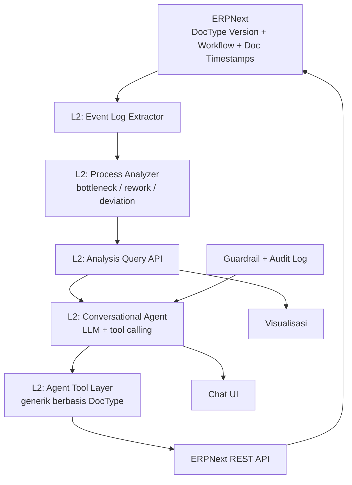

# Software Requirements Specification (SRS)
## Smart ERP — Agentic Process Intelligence di atas ERP Open Source

Versi: 1.0 — **Target: Submission ANGEL Innovation Hackathon 2026**
Industry Track: **Artificial Intelligence**
Industrial Challenge: **Topik 2 (AI-Driven Process Intelligence & Optimization)** + **Topik 3 (Conversational AI for Business Process Execution)**

> Dokumen ini adalah spesifikasi **versi final yang siap dikumpulkan ke juri**. Semua item bertanda
> `[MVP]` **wajib** selesai dan terbukti di video/screenshot demo. Item `[STRETCH]` dikerjakan hanya
> bila waktu tersisa. Item `[ROADMAP]` **tidak** dikerjakan di hackathon, hanya disebut di proposal.

---

## 1. Tujuan Dokumen

Menjadi acuan tunggal bagi 3 developer selama 5 hari, sekaligus lampiran teknis proposal 3 halaman.
Dokumen ini juga menjadi kontrak antara tim teknis dan tim dokumen (metrik, batasan orisinalitas).

## 2. Latar Belakang & Problem Statement

Industry Problem Owner (PT Javan Cipta Solusi) mendefinisikan tantangannya dalam bahasa **proses
bisnis**, bukan bahasa ERP: SOP, BPMN, event log, deviasi, dan eksekusi task. Perusahaan sudah
memiliki sistem ERP, tetapi:

1. **Tidak tahu di mana proses tersendat.** Data eksekusi (approval, rework, deviasi) tersimpan sebagai
   riwayat dokumen, tetapi tidak pernah dibaca sebagai *event log* untuk dianalisis.
2. **Rekomendasi perbaikan tidak langsung dieksekusi.** Analis menemukan bottleneck, tetapi eksekusi
   perbaikan tetap manual, berpindah aplikasi dan orang.
3. **Investigasi reaktif dan manual.** Untuk menjawab satu pertanyaan proses ("mengapa PO tertahan?"),
   tim harus membuka banyak dokumen satu per satu.

**Sasaran pengguna:** operation manager / process owner di perusahaan yang memakai ERP.
**Target kinerja:** waktu menjawab pertanyaan proses turun dari menit ke detik; analisis bottleneck
menjadi sadar-proses (bukan sekadar laporan transaksi).

## 3. Positioning Produk (Penting untuk Penilaian IP & Tema)

| Layer | Kode | Lisensi | Pemilik |
|---|---|---|---|
| **L1 — ERP core** | ERPNext (reference implementation) | GPLv3 | Frappe Technologies (open source) |
| **L2 — Agentic process intelligence** | `apps/smart_erp_ai` | Milik tim | **KARYA ORISINAL TIM INI** |

**Klaim nilai utama:** *Process intelligence + conversational execution dalam satu loop.*
Alur: **dari data proses → analisis → rekomendasi → eksekusi via percakapan.**

Sistem **bukan** pengganti ERP, **bukan** rebrand ERPNext, dan **bukan** klaim atas "seluruh fitur
ERPNext". ERPNext diposisikan jujur sebagai fondasi & sumber data.

## 4. Ruang Lingkup

### 4.1 In Scope (5 hari, siap submission) — `[MVP]`

- **F1** Ekstraksi event log dari ERPNext (DocType `Version` + workflow/timestamp dokumen).
- **F2** Analisis bottleneck: rata-rata waktu antar tahap proses Purchase-to-Pay (P2P).
- **F3** Analisis rework & deviasi proses (dokumen kembali/melewati urutan normal).
- **F4** Visualisasi sederhana (satu grafik/tabel + satu diagram alur).
- **F5** Conversational agent dengan tool calling ke ERPNext REST API (layer generik berbasis DocType).
- **F6** Satu alur end-to-end: **Purchase-to-Pay** (buat Purchase Order → approve → cek status).
- **F7** Jembatan analisis→aksi: agen menjawab pertanyaan proses lalu menawarkan eksekusi lanjutan.
- **F8** Guardrail: konfirmasi manusia sebelum aksi tulis, blokir aksi destruktif, audit log.

### 4.2 Out of Scope (5 hari) — sebut sebagai `[ROADMAP]`

- Order-to-Cash / modul lainnya (cukup disebut roadmap).
- Voice interface, multi-agent orchestration, fine-tuning model.
- Integrasi ke ERP selain ERPNext (di luar adapter layer yang sudah dirancang).
- Dashboard kompleks, modul HR/manufacturing, aplikasi mobile.

### 4.3 Requirement Minimum Resmi (Guideline §2.3) — Harus Lulus

| Topik | Minimum Wajib | Status yang harus dibuktikan |
|---|---|---|
| 2 | Baca sample event log → **minimal satu** analisis (bottleneck/rework/deviasi/visualisasi) | F1 + F2 + F4 |
| 3 | Chatbot mendemonstrasikan **minimal satu** skenario proses (tampilkan tugas / terima input / pandu task) | F5 + F6 |

Sistem kita **melampaui** minimum karena menyambungkan keduanya (F7).

## 5. Arsitektur Sistem

**Prinsip desain:** satu vertical slice yang mulus, bukan kumpulan fitur lebar-tapi-dangkal.
`L2` dirancang modular (`agent/`, `process_intelligence/`) agar bisa diangkat menjadi layanan
terpisah (`[ROADMAP]` hilirisasi ke sistem lain via adapter layer).

## 6. Functional Requirements Detail

### F1 — Event Log Extractor `[MVP]`
- Sumber: DocType `Version` (riwayat perubahan doc), field workflow state, dan timestamp dokumen.
- Output tabel kanonik: `case_id | activity | timestamp | actor | doctype | reference`.
- Requirement: minimal mencakup alur Purchase-to-Pay (Purchase Order → Purchase Receipt → Purchase Invoice).
- Acceptance: `bench execute` / script tunggal yang menghasilkan ≥200 baris event log dari data seed.

### F2 — Bottleneck Analysis `[MVP]`
- Hitung rata-rata dan median durasi antar tahap proses; tandai tahap di atas threshold.
- Acceptance: menghasilkan daftar peringkat tahap teratas dengan durasi rata-rata, dapat dibaca agen & UI.

### F3 — Rework & Deviation Analysis `[MVP]`
- Deteksi dokumen yang kembali ke tahap sebelumnya (rework) atau melewati urutan normal (deviasi).
- Acceptance: menghasilkan jumlah kasus rework + contoh kasus konkret (id + aktivitas).

### F4 — Visualisasi `[MVP]`
- Satu grafik batang durasi antar tahap + satu diagram alur beranotasi bottleneck.
- Acceptance: tampil di UI, bisa di-screenshot bersih untuk bukti Prototype Alpha.

### F5 — Conversational Agent + Tool Layer `[MVP]`
- Layer tool **generik berbasis DocType** (bukan tool per fitur):
  `list_documents`, `get_document`, `create_document`, `update_document`, `submit_document`.
  Tool `submit`/`approve` memperlakukan approval sebagai aksi tulis berisiko → wajib konfirmasi (F8).
- Acceptance: agen dapat membuat satu Purchase Order melalui percakapan.

### F6 — Alur End-to-End Purchase-to-Pay `[MVP]`
- Skenario: "buat PO untuk vendor X, 10 unit item Y" → konfirmasi → dokument terbentuk di ERPNext →
  "status PO itu sekarang apa?" → agen menjawab dari ERPNext.
- Acceptance: dokumen nyata terbentuk dan dapat diverifikasi di ERPNext Desk.

### F7 — Jembatan Analisis → Eksekusi (Nilai Jual Utama) `[MVP]`
- Skenario: "di mana bottleneck proses pembelian bulan ini?" → agen memanggil modul analisis →
  menjawab → menawarkan lanjutan ("ada N PO tertahan approval; mau saya tampilkan daftarnya?").
- Acceptance: **satu skenario mulus** yang menyambungkan F2/F3 dengan F5/F6.

### F8 — Guardrail & Audit `[MVP]`
- Eksekusi memakai permission user yang sedang login (bukan superuser).
- Konfirmasi manusia eksplisit untuk semua aksi tulis.
- Blokir aksi destruktif (`delete`, `cancel`) di level tool layer.
- Audit log setiap aksi agen: waktu, user, tool, argumen, hasil.
- Acceptance: 3 guardrail di atas terbukti di demo.

## 7. Non-Functional Requirements

| Kode | Requirement | Target |
|---|---|---|
| NFR1 | Waktu respons agen | < 10 detik untuk 1 tool call (LLM eksternal) |
| NFR2 | Auditable | 100% aksi tulis tercatat di audit log |
| NFR3 | Aman | 0 aksi destruktif dapat dieksekusi |
| NFR4 | Reproducible | `scripts/` dapat menjalankan seed data + demo dari nol |
| NFR5 | Portabilitas hilirisasi | Layer analitik & agent terpisah dari ERP (adapter layer) |
| NFR6 | Ekonomis | LLM via API eksternal, **tidak** hosting model sendiri |

## 8. Data Requirement

ERPNext hasil `new-site` **kosong**. Wajib ada **data dummy realistis**:
- 200–500 kasus Purchase-to-Pay.
- Sengaja mengandung **bottleneck** (PO tertahan di approval) dan **rework** (dokumen kembali/mundur).
- Dibuat oleh script idempoten sehingga bisa di-reset pra-demo.

## 9. Alur Demo (3–4 pertanyaan tetap, dijamin jalan)

1. "Buat Purchase Order untuk Vendor A, 10 unit Item X." → konfirmasi → PO terbentuk.
2. "Apa status PO yang baru dibuat?" → agen membaca dari ERPNext.
3. "Di mana bottleneck proses pembelian bulan ini?" → analisis + grafik.
4. "Tampilkan daftar PO yang tertahan di approval dan kirim reminder." → jembatan analisis→aksi.

## 10. Metrik Validasi (untuk proposal & TKT)

- **Task Success Rate:** dari ≥20 perintah uji, persentase dieksekusi benar (target ≥80% pada skenario demo tetap).
- **Akurasi ekstraksi event log:** kecocokan terhadap data seed yang diketahui (target ≥90%).
- **Perbandingan manual:** waktu menjawab pertanyaan proses vs membuka dokumen manual.

## 11. Kepatuhan, Lisensi & IP

1. **Lisensi:** ERPNext/Frappe = **GPLv3**; kode `smart_erp_ai` = milik tim. Batasan lengkap ada di
   `docs/AGENT-RULES.md` (bagian Lisensi).
2. **Rencana distribusi:** **cloud-only** (SaaS), hosting sendiri, kode tidak didistribusikan ke pengguna
   → kewajiban GPLv3 (conveying source) **tidak aktif**. Jangan memberi kode ke klien; bila kelak
   diperlukan (on-premise), wajib buka source bagian turunan GPLv3.
3. **Trademark:** nama/logo "ERPNext" & "Frappe" **tidak** dipakai sebagai bagian nama produk/branding
   komersial (sesuai TRADEMARK_POLICY.md). Rebranding produk adalah keputusan **pasca-hackathon**.
4. **Pakta Integritas:** jujur menyebut ERPNext sebagai base open source; klaim orisinalitas **hanya**
   atas layer L2 (agent + process intelligence). Tidak mengklaim "membangun ERP dari nol".
5. **TKDN & IP (10%):** nilai diambil dari orisinalitas L2 + desain adapter layer, bukan dari rebrand.

## 12. Definition of Done untuk Submission

Sebuah item `[MVP]` dinyatakan **selesai** bila:
- [ ] Berfungsi pada stack yang dijalankan dengan `scripts/` (bukan hanya di mesin satu orang).
- [ ] Terbukti di **video demo pendek** dan **screenshot** (bukti Prototype Alpha, Guideline §2.4).
- [ ] Tercatat di audit log (untuk aksi tulis).
- [ ] Tidak melanggar aturan `docs/AGENT-RULES.md` (layer, lisensi, branding).

**Paket submission:**
- [ ] Proposal 3 halaman (lampiran guideline) — dengan posisi L1/L2 yang jujur.
- [ ] Bukti Prototype Alpha: screenshot UI chat, grafik bottleneck, dokumen PO nyata di ERPNext, video 2–3 menit.
- [ ] Repository dengan `docs/AGENT-RULES.md` + `docs/SRS.md` ini.
- [ ] Metrik §10 terisi dengan angka nyata dari demo.

## 13. Roadmap Pasca-Hackathon (untuk bagian Hilirisasi proposal)

- Adapter layer multi-ERP (Odoo/SAP) — inti cerita hilirisasi.
- Perluasan alur Order-to-Cash & modul HR/manufacturing.
- Multi-agent + voice; fine-tuning opsional.
- Rebranding produk cloud + penyiapan HKI atas L2.
